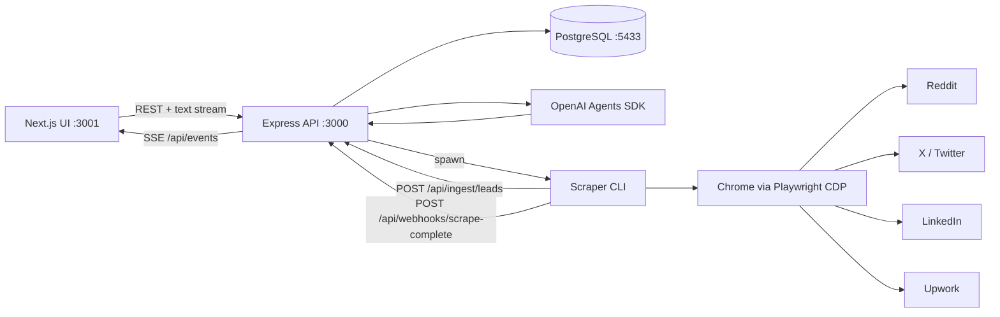

# LeadGun Architecture

## Overview

LeadGun is a two-process application:

1. A **Next.js UI** on `http://localhost:3001`.
2. A **Node.js/Express API** on `http://localhost:3000`.

The Express API owns all business logic: lead data, chat, AI tools, scrape jobs, ingestion, notifications, and PostgreSQL access through Prisma. The Next.js app is the user interface only; it has no API routes of its own.

Scraping runs in a separate child Node.js process. That process uses Playwright to control Chrome through the Chrome DevTools Protocol (CDP), collects leads, writes JSON snapshots, and posts normalized leads back to the Express ingestion API.



## Runtime Processes

| Process | Default port | Entry point | Responsibility |
| --- | --- | --- | --- |
| Express API | `3000` | `src/server.js` | REST API, chat, AI tools, scrape-job tracking, Prisma access |
| Next.js UI | `3001` | `web/` | Dashboard, lead explorer, AI chat, outreach UI |
| Scraper worker | none | `src/cli.js` | Playwright scraping, filtering, Discord notification, DB ingestion |
| PostgreSQL | `5433` | `.pgdata` cluster | Persistent lead, chat, outreach, and scrape-job data |
| Chrome | `9222` CDP | Playwright | Logged-in browser session used by all scrapers |

The installed launch script `scripts/start-leadgun.sh` starts PostgreSQL, the backend, and the UI. It is registered in the user crontab with `@reboot`.

## Repository Layout

```text
LeadGun/
├── src/
│   ├── server.js                 Express bootstrap, cron, boot-time scrape
│   ├── cli.js                    Scraper command-line entry point
│   ├── config/
│   │   └── index.js              Sources, queries, thresholds, schedules
│   ├── routes/
│   │   └── api.js                All HTTP/API routes
│   ├── lib/
│   │   ├── agent.js              OpenAI agent and tool definitions
│   │   ├── openai.js             Shared OpenAI client/model configuration
│   │   ├── normalize.js          Lead normalization for database ingestion
│   │   ├── platform.js           Platform/date/URL helpers
│   │   └── prisma.js             Shared Prisma client
│   ├── jobs/
│   │   └── scrapeJob.js          Full scrape pipeline and persistence
│   ├── scraper/
│   │   ├── redditScraper.js      Reddit feed and search scraping
│   │   ├── xScraper.js           X search scraping
│   │   ├── linkedinScraper.js    LinkedIn search scraping
│   │   └── upworkScraper.js      Upwork job scraping
│   ├── services/
│   │   ├── classifier.js         LLM lead classification
│   │   ├── queryRewriter.js      Natural-language topic to search phrases
│   │   ├── matcher.js            Intent/capability scoring
│   │   ├── freshness.js          Lead age/freshness calculation
│   │   ├── store.js              JSON snapshot storage and merging
│   │   └── discord.js            Discord notifications
│   ├── browser/
│   │   ├── connection.js         Connect Playwright to Chrome over CDP
│   │   └── launchChrome.js       Start Chrome when CDP is unavailable
│   └── utils/                    Human behavior, scraping, verification helpers
├── web/
│   └── src/
│       ├── app/                  Next.js App Router pages
│       │   ├── page.tsx          Overview dashboard
│       │   ├── ai/page.tsx       AI Lead Finder chat
│       │   ├── explorer/page.tsx Lead catalog and filters
│       │   ├── saved/page.tsx    Saved leads
│       │   ├── replies/page.tsx  Outreach and drafts
│       │   ├── activity/page.tsx Activity feed
│       │   └── settings/page.tsx Settings
│       └── components/
│           ├── Sidebar.tsx       Main navigation
│           └── LeadCard.tsx      Shared lead card
├── prisma/
│   └── schema.prisma             PostgreSQL models
├── scripts/
│   └── start-leadgun.sh          Boot-time stack launcher
├── data/                         JSON snapshots produced by the scraper
└── docs/                         This documentation
```

## Backend Responsibilities

### `src/server.js`

- Loads environment variables and configuration.
- Starts PostgreSQL locally when the configured cluster exists but is stopped.
- Registers API routes from `src/routes/api.js`.
- Schedules scrapes with `node-cron`.
- Optionally runs a scrape on startup.
- Exposes runtime status at `GET /api/status`.

### `src/routes/api.js`

All primary APIs are defined here:

| Area | Endpoints |
| --- | --- |
| Health | `GET /health`, `GET /api/status` |
| Ingestion | `POST /api/ingest/leads` |
| Leads | `GET /api/leads`, `GET /api/leads/:id`, `PATCH /api/leads/:id` |
| Outreach | `GET /api/leads/:id/outreach`, `POST /api/leads/:id/outreach` |
| Statistics | `GET /api/stats` |
| AI drafting | `POST /api/ai/draft-reply` |
| Manual scrape | `POST /api/scrape` |
| Chat | `GET /api/chat`, `POST /api/chat`, `GET /api/chat/:id`, `GET /api/chat/leads` |
| Scrape jobs | `GET /api/scrape/jobs`, `GET /api/scrape/jobs/:id` |
| Settings | `GET /api/scrapers`, `PATCH /api/scrapers/:id` |
| Notifications | `GET /api/events`, `POST /api/webhooks/scrape-complete` |

The ingestion endpoint authenticates with `x-ingest-secret` and upserts leads by `postUrl`. Archived and workflow fields are preserved when an existing lead is re-ingested.

### `src/lib/agent.js`

Defines the LeadGun Assistant and its tools:

| Tool | Purpose |
| --- | --- |
| `search_leads` | Query stored leads with filters |
| `get_lead_details` | Read one lead with activity and outreach |
| `get_lead_statistics` | Aggregate stored-lead metrics |
| `update_lead_status` | Change a lead workflow status |
| `save_lead` | Save or unsave a lead |
| `add_lead_note` | Add a lead note/activity |
| `draft_lead_reply` | Generate and store an outreach draft |
| `get_outreach_history` | Read outreach and lead history |
| `extract_lead_emails` | Find email addresses in stored content |
| `rewrite_search_query` | Convert a topic into complete search phrases |
| `run_scrape_job` | Start a background scrape and create a `ScrapeJob` |

The agent streams text back to the browser. Lead results are rendered as cards; the agent is instructed not to repeat lead details as text.

### `src/jobs/scrapeJob.js`

The scrape pipeline:

1. Resolve selected sources and dynamic search phrases.
2. Connect Playwright to Chrome over CDP.
3. Run selected platform scrapers, in parallel where possible.
4. Normalize and filter posts with the matcher.
5. Classify leads with the LLM when enabled.
6. Save JSON snapshots under `data/`.
7. Push leads to PostgreSQL through `/api/ingest/leads`.
8. Send Discord notifications.
9. Post a completion webhook to the backend.

The CLI exits explicitly after completion so that a browser connection cannot keep a scrape process alive indefinitely.

### `src/services/queryRewriter.js`

Converts a natural-language request into 4-6 complete search phrases.

- The LLM produces topic-aware phrases when an OpenAI key is available.
- A deterministic fallback generates role/intent phrases when the LLM is unavailable.
- Validation rejects single generic words such as `software`, `developer`, `remote`, or `jobs`.
- `normalizeScrapeKeywords` also protects the CLI and manual API path.

Example:

```text
Find me remote software dev jobs
  -> remote software developer
  -> remote software developer needed
  -> hire remote software developer
  -> freelance remote software developer
  -> contract remote software developer
  -> remote software engineer
```

## Frontend Responsibilities

The UI uses the Next.js App Router and talks directly to the Express API through `NEXT_PUBLIC_API_URL`.

| Page | Purpose |
| --- | --- |
| Overview | Metrics, platform/status breakdowns, recent activity |
| AI Lead Finder | Streaming chat, conversation history, lead cards, scrape progress |
| Lead Explorer | Search, filters, pagination, card/list views, lead detail, notes, status |
| Saved Leads | Saved lead collection |
| Replies & Outreach | Draft replies and outreach tracking |
| Activity | Recent lead activity |
| Settings | Per-source scraper on/off controls |

The AI page polls `/api/scrape/jobs?conversationId=...` every four seconds. When a job completes, it fetches `/api/scrape/jobs/:id` and appends returned leads to the chat as cards.

Scraper source toggles are stored in `data/scraper-settings.json` and exposed through `GET /api/scrapers` and `PATCH /api/scrapers/:id`. Disabled sources are skipped by scheduled runs and AI-triggered scrapes.

## Data Flow

### Searching existing leads

```text
AI chat
  -> POST /api/chat
  -> LeadGun Assistant
  -> search_leads
  -> Prisma/PostgreSQL
  -> streamed short response
  -> UI fetches /api/chat/leads
  -> lead cards
```

### Starting a new scrape

```text
AI chat
  -> POST /api/chat
  -> run_scrape_job(topic, sources)
  -> query rewriter
  -> ScrapeJob(status=scraping)
  -> spawn src/cli.js
  -> scrapers + matcher + classifier
  -> POST /api/ingest/leads
  -> CLI exits
  -> ScrapeJob(status=completed, leadIds=[...])
  -> UI polling loads job detail
  -> lead cards in chat
```

### Scheduled scraping

`node-cron` runs `runScrapeJob` every three hours inside the backend process. `npm start` also runs an initial scrape unless `--no-scrape` is passed. `npm run dev` starts without a startup scrape; `npm run dev:scrape` includes one.

## Database Models

| Model | Purpose |
| --- | --- |
| `Lead` | Normalized lead, source metadata, score, workflow state, freshness |
| `User` | Application user; defaults to `default-user` |
| `ChatConversation` | Chat thread metadata |
| `ChatMessage` | Persisted user/assistant messages |
| `LeadActivity` | Notes, status changes, discovery, drafts, outreach events |
| `Outreach` | Outbound/inbound messages and delivery/reply state |
| `ScrapeJob` | Background scrape status, sources, final keywords, lead IDs, output/error |

Lead lists exclude archived leads by default. Freshness is derived from `postedAt` first, then discovery/source timestamps.

## Configuration

| Variable | Purpose |
| --- | --- |
| `DATABASE_URL` | PostgreSQL connection string |
| `OPENAI_API_KEY` | LLM classification, rewriting, agent, drafting |
| `OPENAI_MODEL` | Optional model override |
| `INGEST_URL` | Backend lead-ingestion endpoint used by the scraper |
| `INGEST_SECRET` | Shared ingestion/webhook secret |
| `DISCORD_BOT_TOKEN` | Discord notification bot token |
| `CDP_URL` | Chrome DevTools Protocol URL |
| `CHROME_PATH` | Chrome executable |
| `CHROME_PROFILE_DIR` | Persistent Chrome profile |
| `PGDATA` / `PGCTL` | Local PostgreSQL data path and control binary |

Source lists, query defaults, scoring thresholds, age windows, and schedules live in `src/config/index.js`.

## Common Commands

```bash
npm run dev          # backend + UI, no startup scrape
npm run dev:scrape   # backend + UI, with startup scrape
npm start            # backend only, with scheduled/startup scrape
npm run scrape -- --x --keywords="remote software developer"
npx prisma db push   # apply schema changes to PostgreSQL
```

## Design Conventions

- The backend is CommonJS Node.js; the UI is TypeScript/React.
- All application APIs belong to Express, not Next.js route handlers.
- PostgreSQL is the source of truth for UI workflows; JSON files remain scraper snapshots.
- Scrape jobs are asynchronous and tracked in `ScrapeJob`; chat never waits for a full scrape.
- Search phrases must be complete multi-word phrases, never isolated generic tokens.
- Discord notifications remain a first-class output alongside database ingestion.
